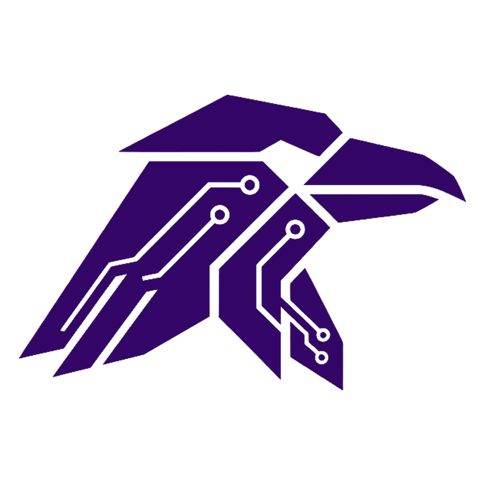

# Raven Browser

A fast, lightweight browser with a liquid glass design, built to use less RAM
than Chrome. For Windows and Android.

> Status: early development. No release yet.

## Planned features

- Liquid glass interface with dark and light themes, plus a community theme store
- Tab sleeping, a flexible RAM limit, automatic tab cleanup and game mode
- Built-in ad and tracker blocking
- Chrome extensions
- Passwords, autofill and session restore
- Optional sync through your own Supabase server, end-to-end encrypted
- AI side panel for Claude, ChatGPT or Gemini, using your own account
- Split view, vertical tabs, workspaces and a command palette

## Built with

Rust, Tauri and WebView2 on Windows, Android WebView on Android.

## Design

Raven's look follows [unslop](https://github.com/heydamir/unslop) by Damir
Sokolovsky (CC BY 4.0): quiet surfaces, one accent from the Raven logo.
It ships with two themes, Solid and Glass, and a glass darkness slider.

## Contributing

Contributions are welcome. See [CONTRIBUTING.md](CONTRIBUTING.md).

## License

Raven Browser is free to use, and its source code is open to read, modify
and contribute to. Modified versions may not be published separately or
under another name. See [LICENSE](LICENSE) and [TRADEMARK.md](TRADEMARK.md).

---

**Türkçe:** Raven, Chrome'dan daha az RAM kullanan, liquid glass tasarımlı,
hızlı ve hafif bir tarayıcıdır. Ücretsizdir, kodu herkese açıktır ve
herkes katkı verebilir. Değiştirilmiş sürümler ayrı ya da başka bir isimle
yayınlanamaz.
